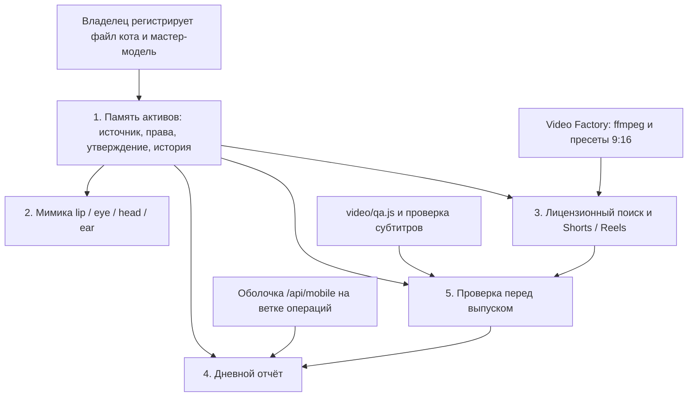

# Дорожная карта: общая память активов и четыре соседние функции

Дата: 20 октября 2026. Ветка: `feat/studio-intelligence`. Черновик, без слияния и без релиза.

Цифры ниже — оценка в рабочих днях, не календарный план студии. День здесь значит один проход по уже известному коду, без ожидания людей. Срок сдвинется, если владелец ещё не положит файл мастер-модели или если ветки №1–№3 нельзя будет соединить.

Пять функций:

1. Общая база: источник, права, утверждение и история использования каждого актива (эта ветка, разработчик №5).
2. Мимика 3D-кота MOONKATTY NEWS по аудио: губы, глаза, голова, уши (разработчик №1).
3. Лицензионный поиск фото и видео, нарезка Shorts/Reels из длинного выпуска, повтор готового файла без второй копии (разработчик №2).
4. Дневной отчёт студии и вид с телефона (разработчик №3).
5. Техническая проверка ролика перед выпуском: звук, субтитры, формат, битые кадры, наличие прав (разработчик №4).

## Что уже лежит в репозитории

Повторный осмотр веток (кончики на 20 октября 2026) — в разделе 8 `AUDIT.md`. Коротко:

| Функция | Уже есть | В этой ветке | Не делается здесь |
|---|---|---|---|
| 1. База активов | Не было общего реестра. Лицензия сюжета живёт в JSON новостей, права картинки — в guardrails поста, музыка без лицензии не принимается | Карточки `si_assets`, права, использования, журнал утверждений с `auto_execute = 0`, схемы и тесты | Вторая база, свой ffmpeg, публикация, подмена кота |
| 2. Мимика | Исполнитель задач и очередь `render_segment`. Blender и каналы lip/eye/head/ear в коде отсутствуют | Контракт: только утверждённая мастер-модель, запись использования, `executed: false` | Расчёт кадров |
| 3. Поиск и нарезки | Пресеты 9:16, ffmpeg, дедуп сюжетов по URL. Поиска стоков и автонарезки длинного выпуска нет | `register` / `findReusable` / `recordUsage` | Скачивание стоков и вызов ffmpeg |
| 4. Отчёт и телефон | `core.buildReport` по коллекциям панели. На `feat/studio-operations` есть `/api/mobile/summary` и `public/mobile.js`; они не читают `si_*` | `reports.daily`, флаг `compact` | Экран телефона и сторож |
| 5. Проверка ролика | `video/qa.js` (кодек, размер, fps, звук, LUFS) и проверка SRT. Битых кадров и прав из общей памяти нет | `qa.rightsForPublication`, `qa.recordFinding` | Открытие файла |

## Оценка

| Функция | Состояние контракта с памятью | Что осталось сделать | Оценка |
|---|---|---|---|
| 1. База активов | Запись и чтение в этой ветке, тесты зелёные | Вызов из `server.js`, когда этот файл можно менять. Сами файлы кота библиотека не ищет | 2–4 дня на проводку в хост после свободного `server.js`. Юридическую проверку лицензии оценка не включает |
| 2. Мимика | `approvedCharacterModel`, `prepareFacialUse`. Пишет агент `video`. `design3d` модель видит, аудио новостей — нет | Каналы губ, глаз, головы и ушей в Blender поверх утверждённого файла. Пока владелец не зарегистрирует путь мастер-модели, старт бессмысленен | 8–15 дней работы №1 после появления файла модели |
| 3. Поиск и нарезки | Дедуп по хешу и адресу, история `shorts` / `reels` / `episode` / `publication` | Коннектор лицензионного поиска, который пишет `register`. Нарезка длинного выпуска существующим ffmpeg и пресетом, затем `recordUsage`, чтобы повтор не плодил файл | Поиск 6–10 дней. Нарезка 5–8 дней. Оба зависят от функции 1 и от уже собранного Video Factory |
| 4. Отчёт и телефон | `reports.daily`. Пустая стоимость и пустое здоровье дают `available: false` | Встроить чтение в мобильную сводку, не заменяя `buildReport` и не рисуя второй экран | 3–5 дней после того, как эту ветку и `feat/studio-operations` можно соединить |
| 5. Проверка перед выпуском | Чтение прав и запись `sound` / `subtitles` / `format` / `corrupted_frames` / `rights`. `blocking` ничего не публикует | №4 вызывает `rightsForPublication` до выпуска и кладёт сюда результат своего ffprobe. Отдельный проход по битым кадрам в `qa.js` ещё не написан | Запись уже посчитанных проверок 4–7 дней. Поиск битых кадров 3–5 дней на стороне медиа |

Функция 1 в части памяти сделана этим изменением. Оценки 2–5 относятся к чужим веткам: их файлы отсюда не редактируются.

## Граф зависимостей

Смысл стрелок:

- Мимика не стартует без утверждённой мастер-модели в памяти.
- Поиск и нарезка пишут в ту же карточку. Без `findReusable` один и тот же ролик заведётся дважды.
- Проверка прав читает использования, которые записала нарезка или монтаж. Свой ffprobe она не заменяет.
- Телефонный отчёт читает память и, когда появятся, находки проверки. Экран уже есть на ветке операций, второй делать не нужно.
- Журнал утверждений стоит на функции 1 и ни одну стрелку сам не исполняет: `executed` остаётся `false`.
